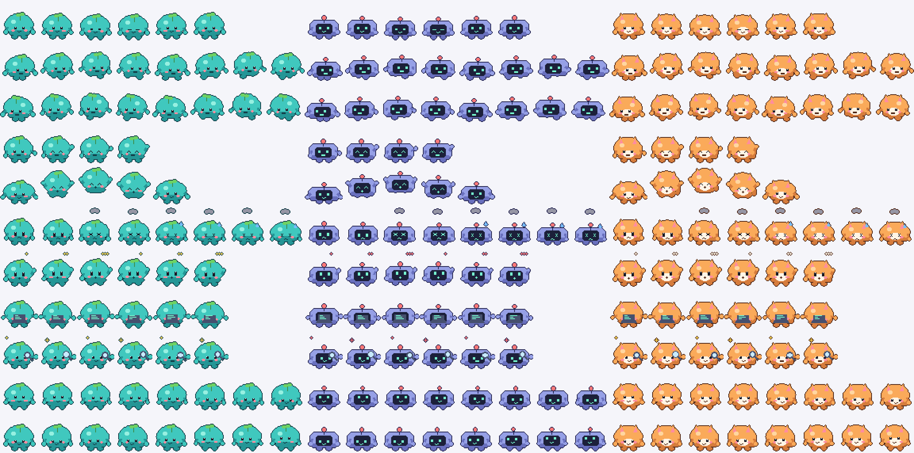

# T3 Mini

A floating desktop pet for [T3 Code](https://t3.codes), inspired by the Pets / Mini overlay in OpenAI's Codex app. It sits above every window and Space, watches your T3 threads, and tells you when one needs you.

> Unofficial community project. Not affiliated with or endorsed by T3 Tools or OpenAI. "Codex" and "ChatGPT" are
> trademarks of OpenAI. The built-in pets are original artwork drawn by `tools/make_pets.py`; no Codex code or assets
> are included.



## What it does

Inspired by the Pets / Mini overlay in OpenAI's Codex app. Full details: [docs/behavior.md](docs/behavior.md).

- **At rest, just the pet.** A small badge on it turns amber when something needs you, green when something is ready.
- **Move the pointer near the pet** and one pill appears below or above it: **＋ New chat** and a **bell** with a
  count. It hides again shortly after you move away.
- **Click the pet** (or ＋) to type a new chat. Pick the project, press Return. Your current app keeps focus.
- **The bell** opens your notifications as a collapsed stack; click or scroll to see them all. Each card shows
  Running · Needs input · Ready · Blocked with a live detail line. **Ready** cards add a two-line digest of the
  agent's reply: what it needs from you, and where things stand. **Click a card** to open that thread in T3, where
  you respond. Hover for **Reply** (a follow-up sent to the thread) and **×** (dismiss). Right-click for Mute / Peek.
- **Drag** the pet anywhere; it stays where you drop it. Hold **Option** while releasing to snap it to one of six
  spots (top or bottom × left, centre, right).
- **Mini mode** (no pet), pet picker (Tee, Bit, Mochi, or your own pets), sizes 80–224 pt,
  **Always visible / On demand**, and **⌃⌥P** to show it and start typing.
- Animations follow the state (each plays 3×, then a slow idle). The pet jumps when hovered and its eyes follow the
  cursor when idle. Reduce Motion is respected.

Not included: voice, attachments, and approving / answering / stopping runs from the overlay (T3 has no API for
that, so cards open the thread in T3 instead).

## Install

Requires macOS 13+, [T3 Code](https://t3.codes) (desktop app, with its `t3` CLI at `~/.t3/bin/t3`), Xcode Command Line Tools, and Python 3 with Pillow (to generate the pets).

```sh
scripts/build-app.sh --install   # builds build/T3 Mini.app, copies to ~/Applications, launches
```

It lives in the menu bar (pawprint). Turn on **Launch at Login** from that menu.

## Control

- Menu bar (pawprint): current notifications, Show / Hide Mini, Quick Chat…, Mode, Pet, Pet Size, Visibility,
  Muted chats, Launch at Login, Open T3 Code, Quit.
- Pet: click = new chat, drag = move (⌥ on release = snap), right-click = the same menu.
- Shortcut: **⌃⌥P** shows T3 Mini and focuses the chat field; press again to close it.
- URLs (scriptable): `open t3mini://show|hide|toggle|chat|activity|mini|pet|unmute`.

## How it reads T3

Read-only. It opens `~/.t3/userdata/statev2.sqlite` with `mode=ro` + `query_only`, polls `PRAGMA data_version` every 0.5 s, and re-reads when T3 commits (and at least every 15 s). Tables used: `orchestration_v2_projection_threads` (title, `lastVisitedAt`, subagent lineage), `…_runs` (latest run status), `…_runtime_requests` (pending approvals/questions, rolled up from subagents to the parent), `…_turn_items` (what a running thread is doing), `…_messages` (latest reply, Ready digest, peek), `…_provider_sessions` (`lastError`). `T3CODE_HOME` is respected.

Writes go only through T3's public surfaces: the `t3code://` URL scheme and the `t3` CLI.

## Custom pets

Drop a pet into `~/.t3-mini/pets/<name>/` (pets in `~/.codex/pets/<name>/` are read too) and choose **Pet ▸ Reload Pets**:

```json
{ "id": "my-pet", "displayName": "My Pet", "description": "…", "spriteVersionNumber": 2, "spritesheetPath": "spritesheet.webp" }
```

Atlas: 1536×2288 PNG/WebP, 8×11 cells of 192×208. Rows 0–8: idle, running-right, running-left, waving, jumping, failed, waiting, running, review. Rows 9–10: 16 look directions clockwise from up. v1 (1536×1872, 9 rows) also loads.

The built-in pets (Tee, Bit, Mochi) are drawn procedurally by `tools/make_pets.py`.

## QA

`scripts/qa-headless.sh` drives the installed app with synthetic mouse and keyboard input (about 30 checks, about
2 minutes; don't touch the mouse while it runs). It needs Accessibility permission for your terminal and adapts to
the main display's size (1440×900 or larger works best). When it needs Ready cards it starts small throwaway threads
titled "T3 Mini QA …" with your most recently used model, in the project named by `T3MINI_QA_PROJECT` (default
"No project", else your most recent project). They cost a few tokens; archive them afterwards.

## Develop

```sh
swift build
.build/debug/t3mini-check selftest   # state-derivation tests against a synthetic T3 database
.build/debug/t3mini-check dump       # what the pet sees right now
.build/debug/t3mini-check pets assets/pets
.build/debug/t3mini-check digests    # Ready-card digests for your recently finished threads
# Opt-in dev hooks (both write to ~/Library/Logs/T3Mini/; the snapshot includes card titles and any composer draft):
defaults write com.t3mini.app debugSnapshot -bool true   # then: open -g t3mini://debug → state.json
defaults write com.t3mini.app traceEvents -bool true     # mouse/event trace → trace.log
```

Layout: `Sources/T3MiniCore` (SQLite reader, state derivation, pet catalog), `Sources/T3Mini` (AppKit panel, SwiftUI overlay, menu bar, hotkey), `Sources/t3mini-check` (headless checks).

Built with [T3 Code](https://t3.codes). MIT licensed, see [LICENSE](LICENSE).
